

  <h1>robotic arm</h1>
  <h3>by mwezi2000</h3>
  <h3>total time spent : 24.9 hours </h3>

--- 

### journal #1 starting with the project 
time spent : 1.5 hours   

  
so i wanted to make a 4 dof robotic arm that can pick up a small cube (20x20 mm, like 5-10 g) and place it somewhere else. the twist is i wanted to control it with 2 joysticks, so basically a little remote + the arm itself
first thing i did was sit down and figure out how the whole thing is gonna talk to each other  
  
the plan was pretty simple, an arduino nano in the remote reads both joysticks, sends the values over a wire (uart) to an arduino uno sitting in the base, and the uno moves the 4 servos. wrote the whole flow down in my notebook so i dont get confused later lol
  

  joystick 1 does base + shoulder, joystick 2 does elbow + gripper, and every servo gets its own 7805 regulator so nothing browns out :D  

--- 

### journal #2 first fusion part, the servo bracket!  
time spent : 1.8 hours   

  
started the design phase in fusion 360. i had the dimensions of the mg90s servo so i made the part which connects the base to the first arm. placed one servo first, then put the second servo on it and made a bracket that holds both of them together  
  
the idea is one servo's gear turns on the base (rotation) and the other one moves arm 1 up and down, and both can move on their own. ngl being kinda new to fusion, getting every dimension to match the servo was a pain, but the second half was way easier since i could just take measurements off the first servo
  

  
| servo bracket |
| --- |
|  |

--- 

### journal #3 base plate and arm 1  
time spent : 1.6 hours   

  
next up was the base plate and the first arm. for the base i made a round plate with a cross in the middle and 4 mounting holes on the ears so it can sit on spacers above the acrylic base (the electronics go under it)  
  

  
| base plate |
| --- |
|  |

for arm 1 i drew a 2d sketch first and tried to keep it as simple as possible so it doesnt eat too much filament. ended up with two Y shaped pieces joined together with cross bars. also added holes between the links so the servo wires can go through and not hang all over the place

  
| arm 1 |
| --- |
|  |

this is the part that leans the whole arm forward and back with joystick 1 :D

--- 

### journal #4  arm 2 had to get thicc  
time spent : 1.7 hours   

  
arm 2 has to carry the 3rd servo (elbow) AND the gripper servo AND whatever it picks up, so it needed to be way stronger than arm 1. made the walls thicker, made the attachment wider and added some slanted bits to make it stiffer  
  
then i found out about 3d printing tolerance, the printer is never exactly perfect so you need like 0.2-0.3 mm gap or the parts just wont go together. went back and added clearance around the servo pockets on all 4 sides and made the screw holes a bit bigger. honestly i made it way too tight at first, the servo would not have fit at all lol
  

  
| arm 2 |
| --- |
|  |

--- 

### journal #5  gripper time!  
time spent : 2 hours   

the gripper took the longest in cad ngl. i used two spur gears that mesh with each other so when the servo turns one, both fingers close together at the same time (symmetrical). made a top cover plate with holes and cutouts to keep the gears lined up  
  
also added the pivot link and a locating pin so the servo horn connects straight to the driving side. had to keep double checking the hinge pin holes before printing anything cuz i didnt want to reprint this again and again

  
| gripper in fusion |
| --- |
|  |

--- 

### journal #6 tx schematic (the remote)  
time spent : 1.4 hours   

  
moved to the electronics side. the remote is an arduino nano running off a 7.4v 2 cell li-ion. battery goes through a diode (so if i plug it in backwards nothing dies) and a spst switch into vin. the nano's own 5v pin powers both joysticks  
  
joystick 1 goes to A0 and A1, joystick 2 goes to A2 and A3. the push buttons on the joysticks are wired to D2 and D3 but not used for now. D1 (tx) goes out on a red wire and ground on a green wire to the receiver. also threw in a red led with 330 ohm resistor as a power light, (5-2)/10mA is like 300 so 330 it is
  

  
| tx schematic |
| --- |
|  |

--- 

### journal #7 rx schematic (the arm side)  
time spent : 1.5 hours   

  
servos are known for pulling a lot of current and resetting the arduino, so on the receiver side i gave every single servo its own lm7805 regulator with a 0.01uF cap on the input and a 0.1uF on the output. this way if one servo spikes it doesnt mess up the others  
  
the uno sends pwm on D3, D5, D6 and D9 (base, shoulder, elbow, gripper). the battery goes through a diode and a master switch, then to the uno's vin and the 4 regulators separately. also added another led + 330 ohm on the uno as a power light
  

  
| rx schematic |
| --- |
|  |

important thing, tx ground and rx ground are only joined through the green wire, nowhere else

--- 
### journal #8 planning the perfboard 
time spent : 1.2 hours   

i'm not getting a pcb made for this, everything goes on zero pcb (8x18 cm for the remote, 10x10 for the receiver). before soldering i sketched out on paper where every part goes and which jumper goes where on the bottom, cuz last time i soldered without a plan it was a mess  
  
used 5 pin headers for the joysticks instead of soldering them directly, so i can pull them out if something breaks. also color coded the wires, red for 5v, black for ground, yellow for analog, red for tx

that was it for the design phase! now onto actually building it :D

--- 
### journal #9 printing and fitting the parts 
time spent : 1.5 hours   

build phase begins!! printed all the links, brackets and the gripper in black pla+, and the bottom base got laser cut from acrylic  
  
the 0.2-0.3 mm gap from journal 4 actually saved me, the servos slid into the pockets nicely. some screw holes were still a bit tight so i had to clean them up a bit before the m3 bolts went in. used m3 bolts with nuts and spacers to hold the plates together

  
| printed links with servos in |
| --- |
| 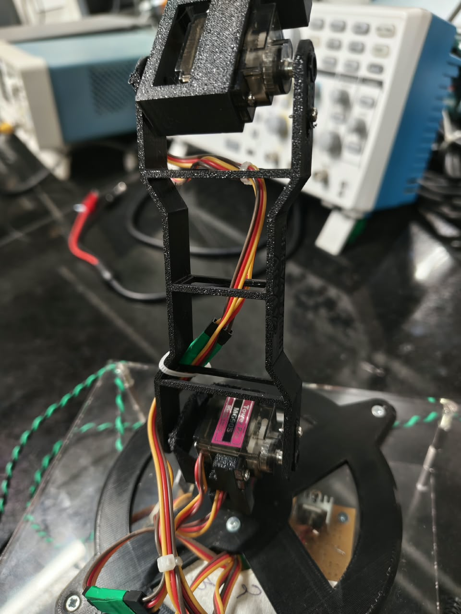 |

zip ties on the cross bars to hold the servo wires, which is why i added those holes earlier :D

--- 

### journal #10 soldering everything! 
time spent : 2 hours   

spent a whole evening soldering. did the tx board first by following the layout from journal 8, then the rx board with the 4 regulators and the servo headers (female berg strips so the servos and uno just plug in)  
  
tested everything with a multimeter before plugging anything in, checked each regulator was giving 5v and that nothing was shorted to ground. one of the joints on the rx board was a cold joint and i had to redo it. the rx board then went under the base plate on spacers, sitting on the acrylic

  
| rx board under the base |
| --- |
| 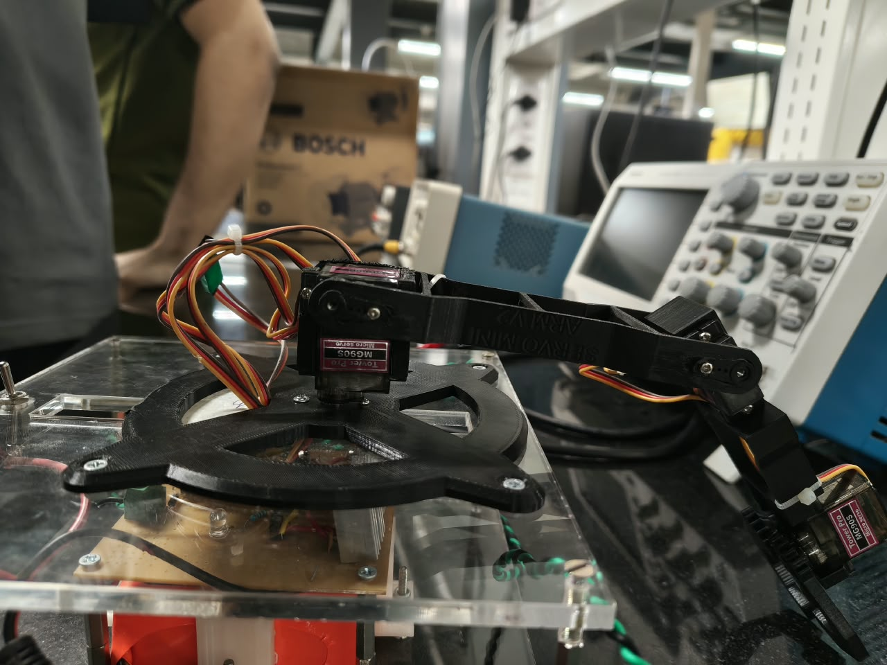 |

| finished remote, front and back |
| --- |
| 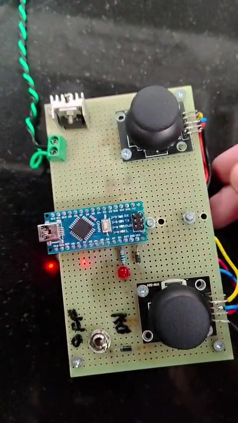 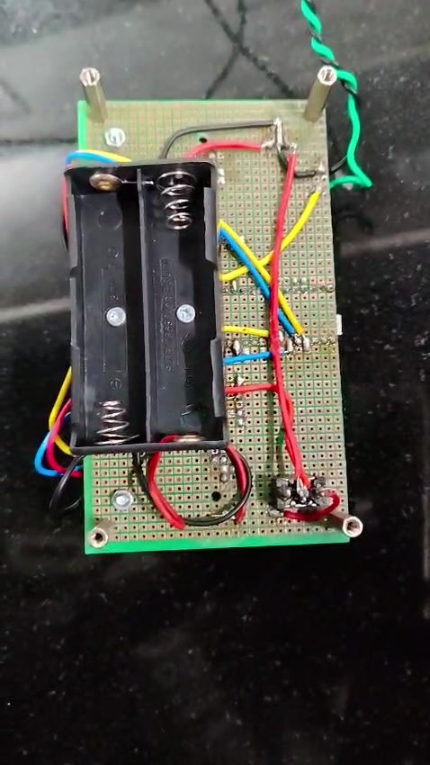 |

the remote came out pretty clean ngl, battery holder on the back and the jumpers all on the bottom side

--- 

### journal #11 tx code and the 255 problem 
time spent : 1.5 hours   

wrote the code for the nano. it reads all 4 analog pins, maps 0-1023 to -255 to +255, and if the value is close to 0 (deadband of 30) it just sends 0, so the arm doesnt drift when you're not touching the sticks. then it sends a packet like <a1,a2,a3,a4> every 50 ms at 9600 baud  
  
my first version didnt even compile lol, i named two pins the same thing, wrote << instead of < in the deadband check, and put the whole thing in setup instead of loop. after fixing that i opened the serial monitor and got.... 255 on everything

  
| serial monitor going crazy |
| --- |
| 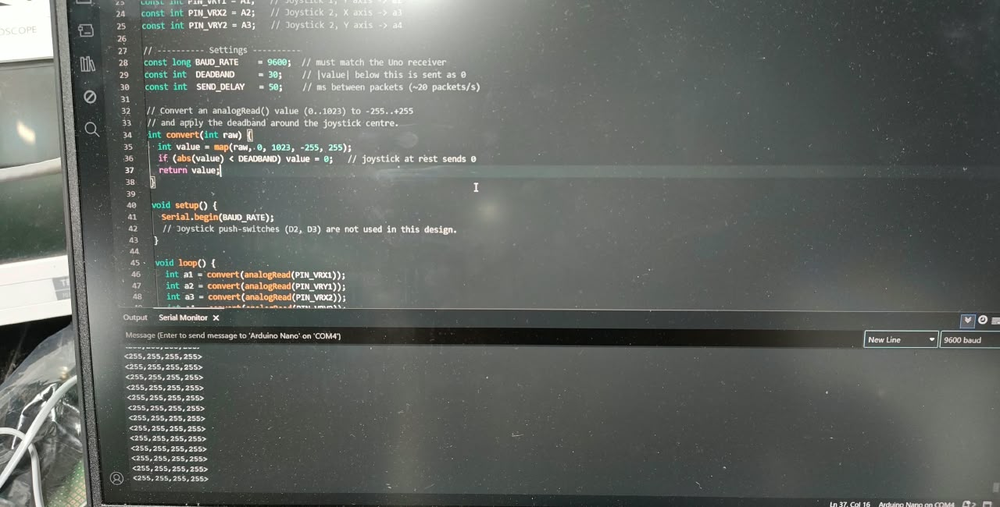 |

all 255 means the nano was reading max value on all 4 pins no matter what i did with the sticks. went back and checked the joystick header wiring and fixed it, after that the values sat at 0 in the middle and went up and down properly when i moved the sticks :D

--- 

### journal #12 rx code 
time spent : 1.8 hours   

the uno code was the bigger one. it reads the serial data, looks for the < and > to find a full packet, checks all 4 numbers are there and between -255 and 255, and throws away anything weird  
  
at first i made the joystick set the angle directly, but the problem is when you let go of the stick the joint goes back to the middle, so the gripper would just drop the cube lol. so i switched to "rate mode", the stick sets the speed of the joint instead, and when you let go it just stays where it is. way better  
  
some other stuff i added:
- min and max angle for every joint so nothing smashes into itself (gripper is 10 to 80 degrees)
- if no packet comes for 500 ms the arm just holds its position
- a servo test mode that sweeps each servo one by one, super useful for checking every regulator branch
- the servos start one at a time with a small delay so they dont all pull current together at power on

also learned the hard way that D0 is shared with the usb, so i had to unplug the red wire from D0 every time i uploaded code and plug it back after. got the "upload failed" error like 4 times before figuring that out

--- 

### journal #13 full assembly 
time spent : 1.6 hours   

put everything together, base plate on the acrylic, bracket on top, arm 1, arm 2 and the gripper at the end. the twisted green and black cable runs from the remote to the receiver  
  
cable management was honestly the most annoying part, 4 servos worth of wires going through a rotating base gets messy real fast. zip tied them along the links and left some slack near the base so it doesnt pull when the base rotates

  
| assembled arm |
| --- |
| 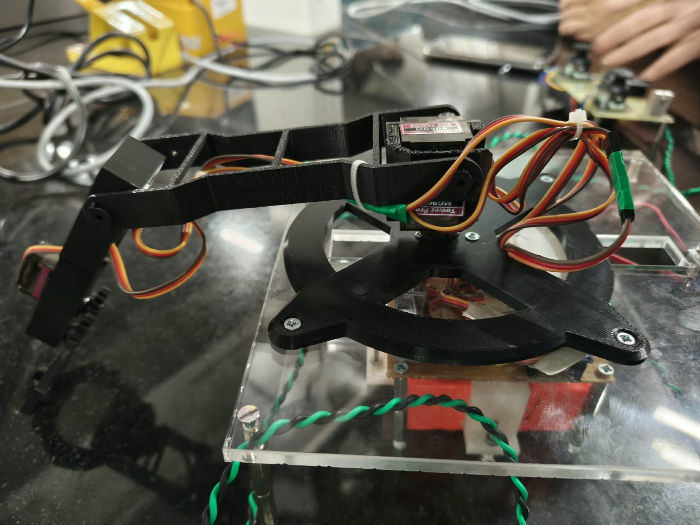 |
| 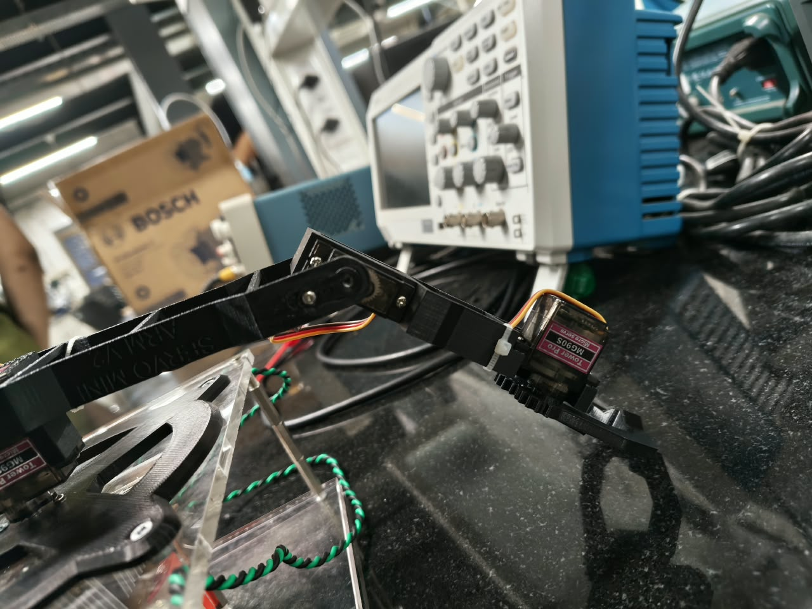 |
| 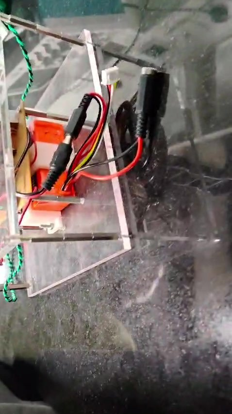 |

--- 

### journal #14 testing and final touches! 
time spent : 1.2 hours   

final testing!! set every joint limit on the real arm so no link hits anything, and flipped the direction on the joints that were moving the opposite way to the stick. the gripper closes on the cube and holds it since in rate mode it doesnt open when you let go of the stick  
  
everything works now, base rotates, shoulder and elbow go up and down and the gripper opens and closes. still want to run it for a while to see if anything breaks, but the arm is basically done :D

  
| gripper |
| --- |
| 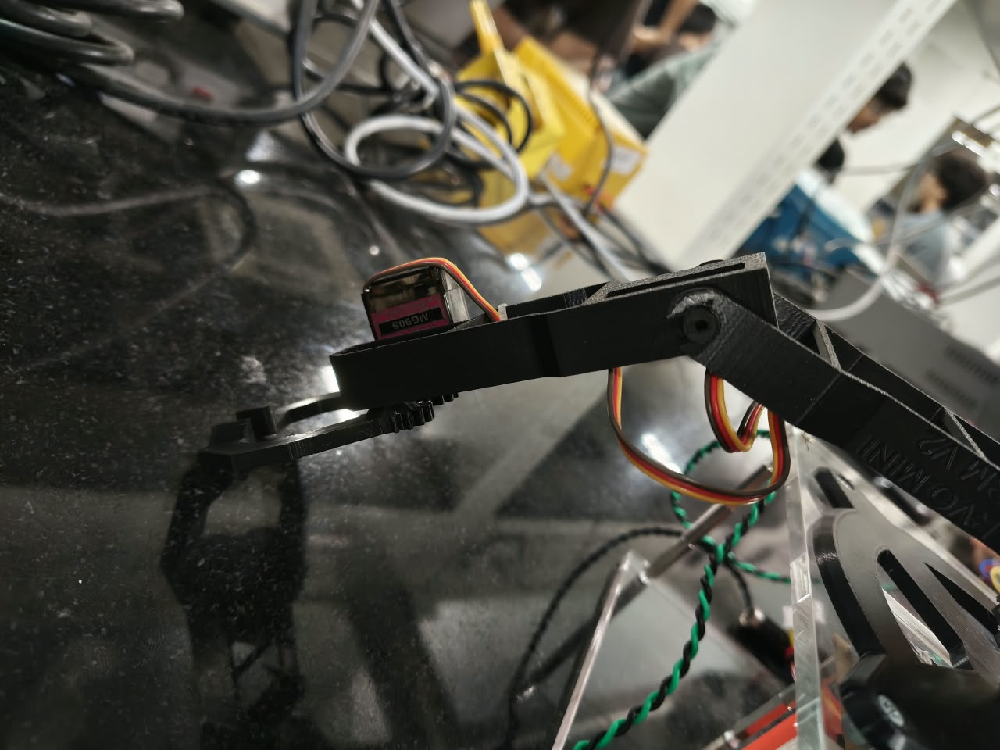 |
| 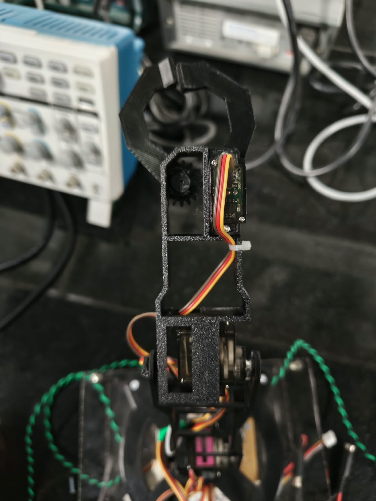 |

| driving it with the remote |
| --- |
| 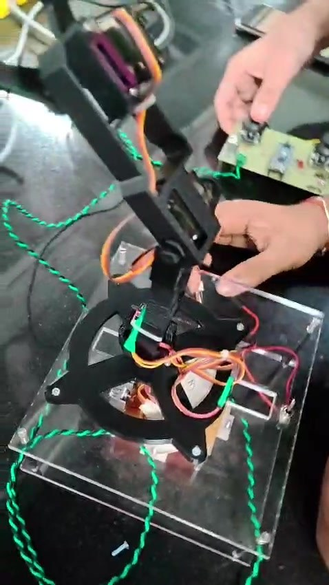 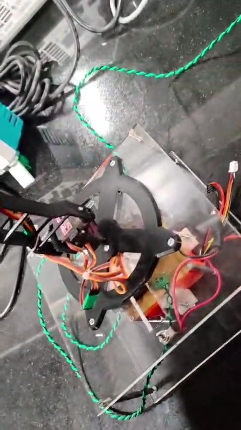 |

here's a video of it moving!

<a href="media/pinchy_demo.mp4">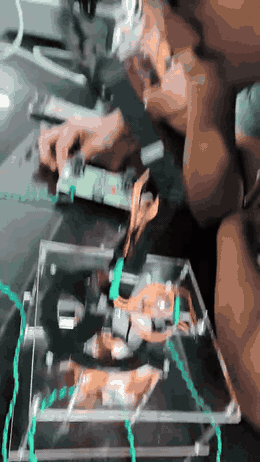</a>

(full video is in media/pinchy_demo.mp4)

--- 

### journal #15 readme time 
time spent : 1.1 hours   

with the arm working i started cleaning up the repo. gave the project a name finally, its called pinchy cuz of the claw :D  
  
wrote the readme with the controls, block diagram, cad, schematics and the bom, and organised all the photos into an images folder. also put both codes into a firmware folder, the old tx code in the repo was the broken version from journal 11 so i swapped in the fixed one.

  
| readme |
| --- |
| 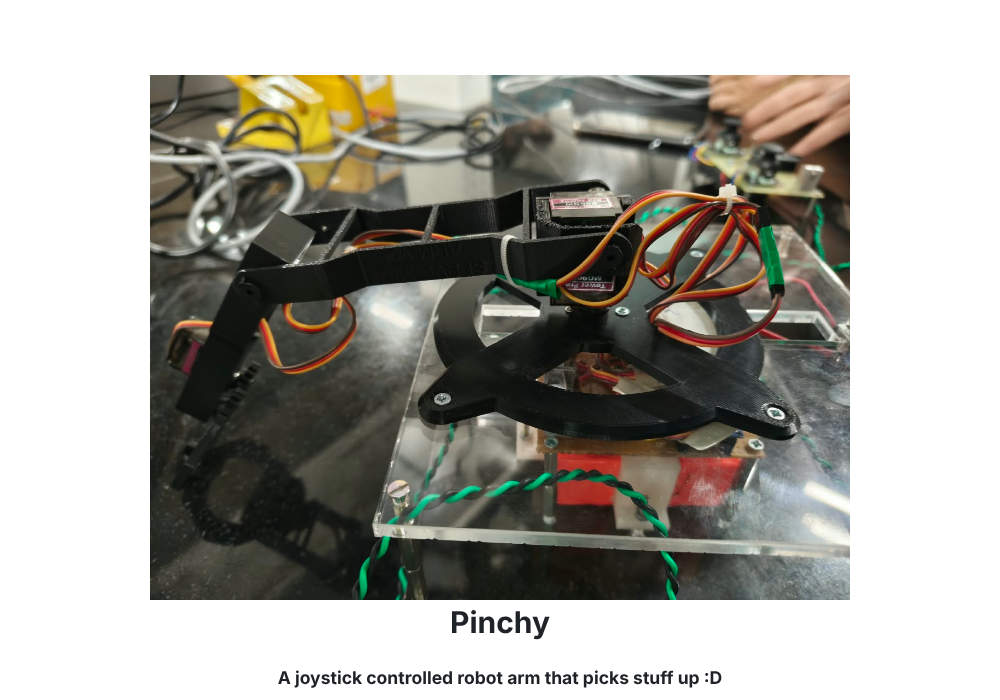 |

--- 

### journal #16 assembly guide 
time spent : 1.5 hours   

last thing was an assembly guide so anyone can build one. went through the whole build again in my head and wrote it step by step, print the parts, solder both boards, test them, center the servos (learned that one the hard way), then base, arms, gripper, cables, code and tuning  
  
also added a troubleshooting table with all the stuff that went wrong for me, like the 255 thing, the D0 upload problem and the arm drifting. made it into a pdf so its easy to print and keep next to you while building

  
| assembly guide |
| --- |
| 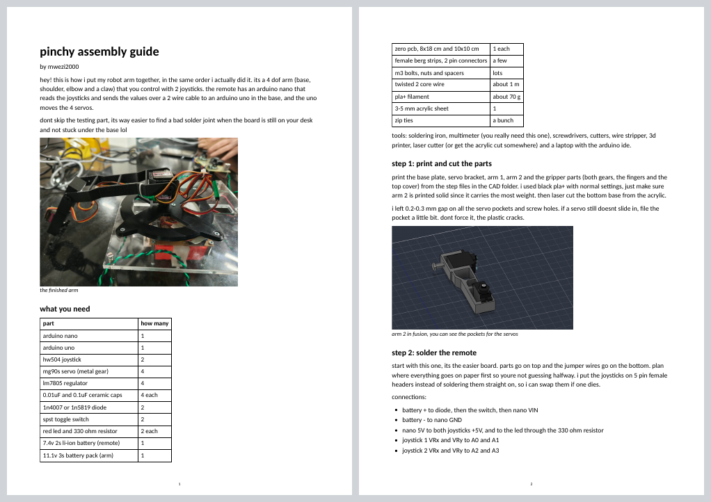 |

this would be the last journal, if you read till here, thank you :D
