<h1 align="center">
 
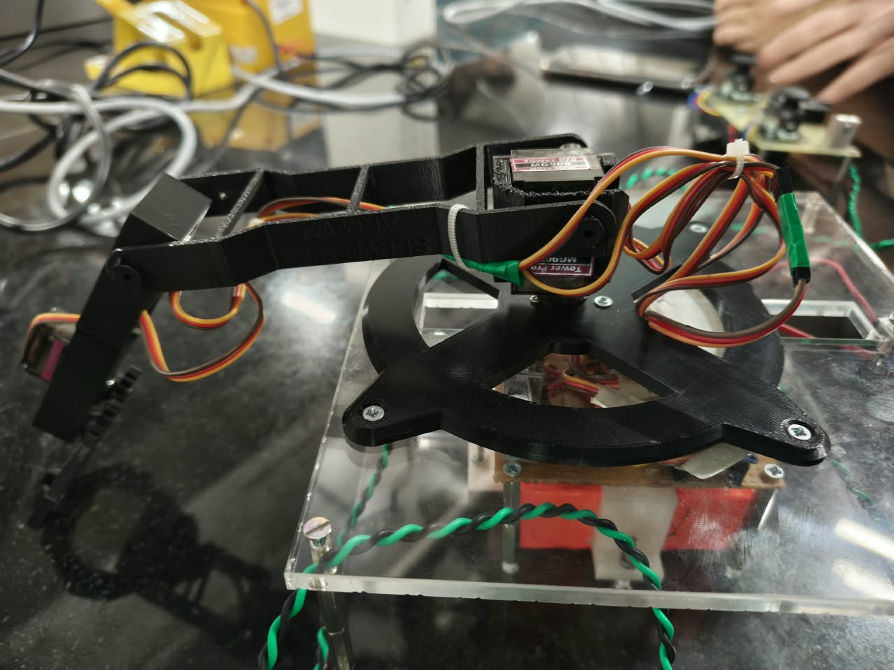
 
Pinchy
 
</h1>

<h3 align="center">

A joystick controlled robot arm that picks stuff up :D

</h3>

  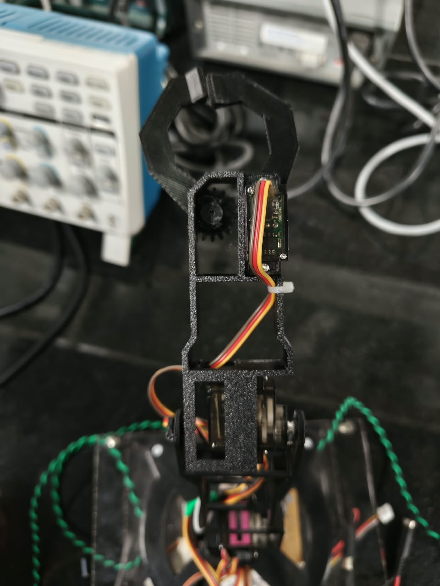
  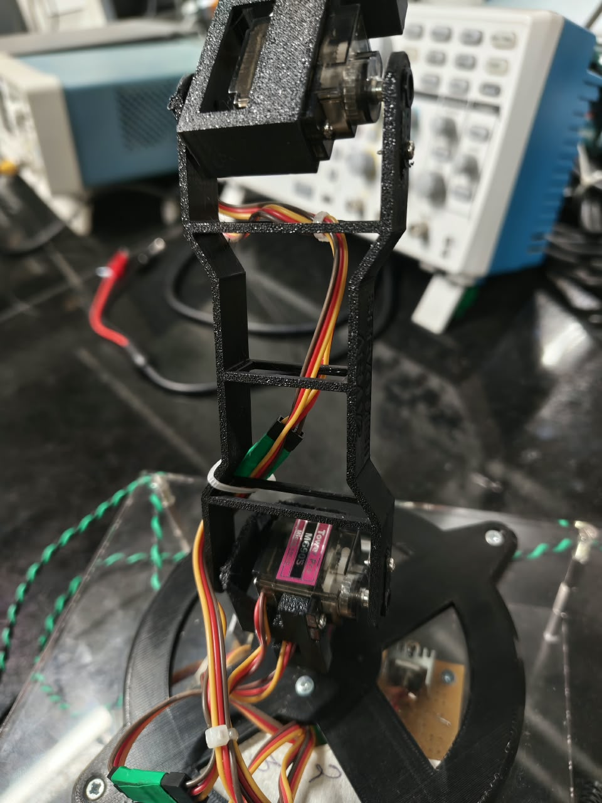

Pinchy is a 4 DOF robot arm (base, shoulder, elbow and a claw) that you drive with 2 joysticks. The remote has an Arduino Nano that reads the sticks and sends the values over a 2 wire cable to an Arduino Uno in the base, which moves 4 MG90S servos. It can pick up a small cube (around 20 mm, 5-10 g) and drop it somewhere else.

All the arm parts are 3D printed in PLA+ and the bottom is laser cut acrylic. I designed everything in Fusion 360.

## Demo

<a href="media/pinchy_demo.mp4">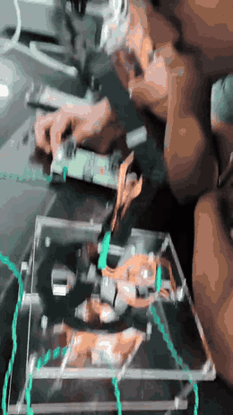</a>

The full video is in [media/pinchy_demo.mp4](media/pinchy_demo.mp4), click the gif to open it.

## Controls

| Joystick | Moves |
| --- | --- |
| Joystick 1 left / right | Base rotation |
| Joystick 1 up / down | Shoulder |
| Joystick 2 left / right | Elbow |
| Joystick 2 up / down | Claw open / close |

The sticks control how fast a joint moves, not where it is. So when you let go the arm just stays there, and the claw keeps holding whatever it picked up.

## How it works

| Remote | Arm |
| --- | --- |
| 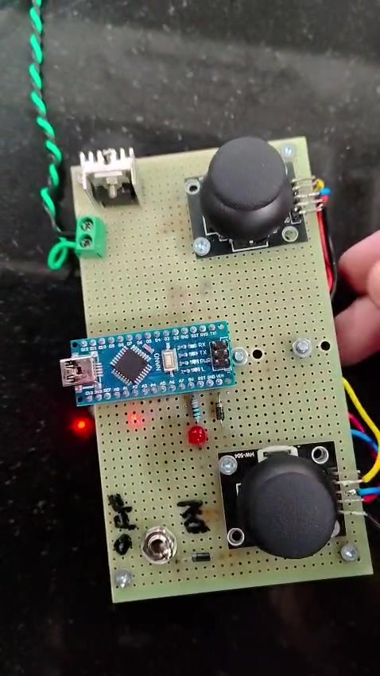 | 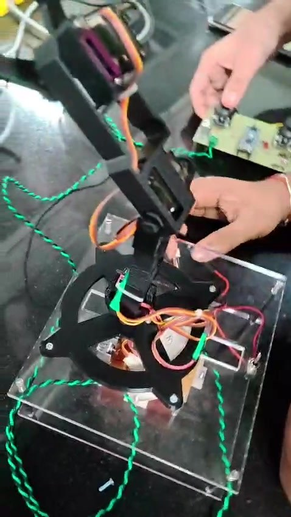 |

The Nano sends a packet like `<0,120,-255,0>` every 50 ms. The Uno checks it, throws away anything broken and moves the servos. If the remote gets unplugged the arm just holds its position. Every servo has its own LM7805 regulator so one servo pulling current doesn't reset the Uno.

## CAD

| Base plate | Arm 1 | Arm 2 |
| --- | --- | --- |
| 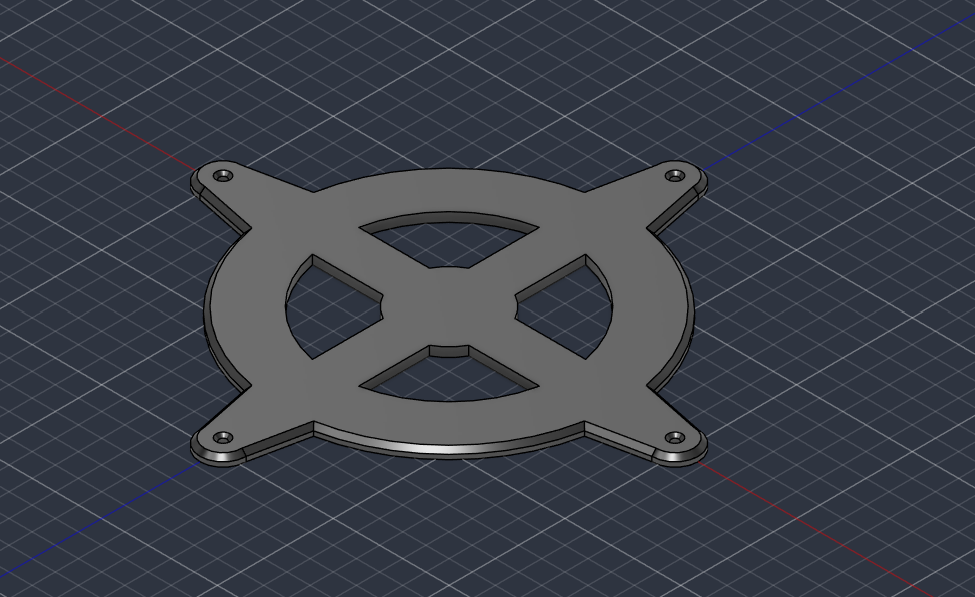 | 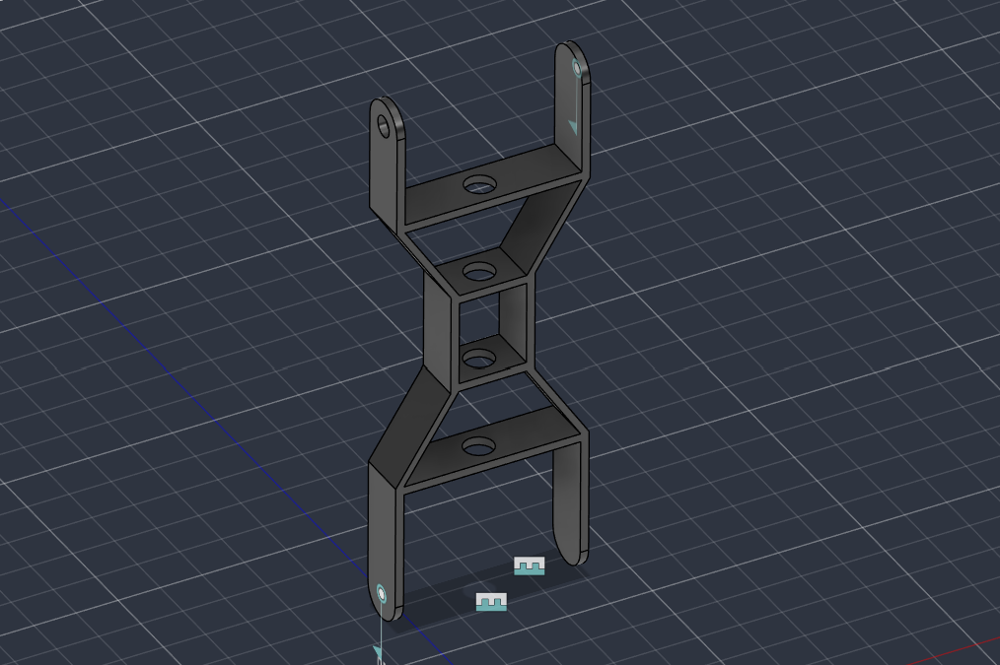 | 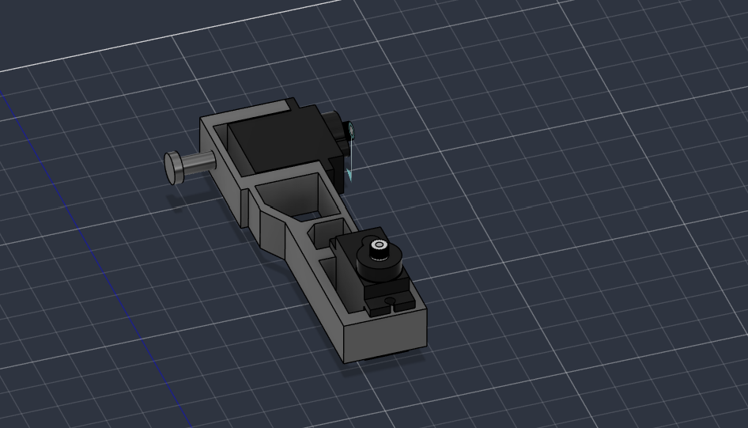 |

| Gripper |
| --- |
|  |

The claw uses two spur gears so both fingers close together.

## Schematics

| Remote (Nano) | Arm (Uno) |
| --- | --- |
|  |  |

There are no PCB files in this repo, both boards were built by hand on perfboard (zero PCB), so the KiCad files are just the schematics. The remote runs on a 7.4V 2S battery and the arm runs on an 11.1V 3S pack.

| Remote, back side | Arm board under the base |
| --- | --- |
| 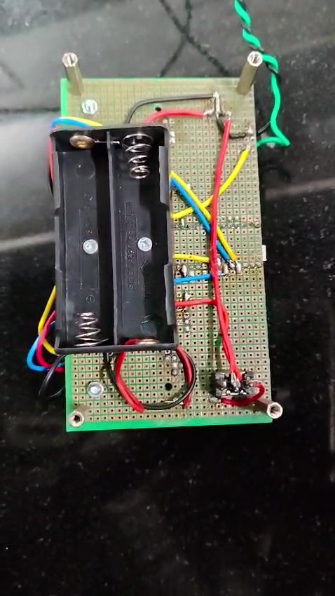 | 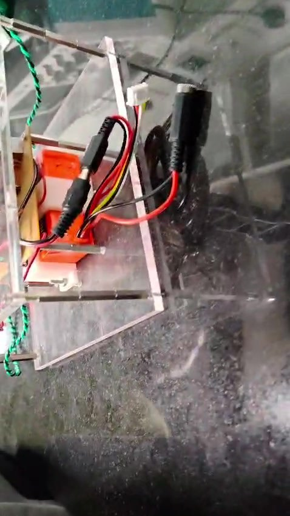 |

## Building one

The full step by step is in the [assembly guide](docs/Pinchy_Assembly_Guide.pdf), and the whole build story is in [JOURNAL.md](JOURNAL.md).

`firmware/Tx_Nano_Joystick` goes on the Nano and `firmware/Rx_Uno_Servo` goes on the Uno. One thing to remember, unplug the wire on the Uno's D0 pin before uploading or it fails.

## Files

| Folder | What's inside |
| --- | --- |
| `CAD/STEP` | Base plate, arm assembly and gripper from Fusion 360, plus the MG90S model I used for sizing |
| `PCB` | KiCad schematics for the remote (`transmitter`) and the arm (`receiver`). Only schematics, no board files since it's all on perfboard |
| `firmware` | Arduino code for the Nano and the Uno |
| `docs` | Assembly guide PDF |
| `art` | Krita art files with PNG previews |
| `images` | Photos and renders used in the docs |
| `media` | Demo video and a gif preview of it |
| `BOM.csv` | Full parts list |

## BOM

Full list with specs is in [BOM.csv](BOM.csv). The main stuff: Arduino Nano, Arduino Uno, 2 HW504 joysticks, 4 MG90S servos, 4 LM7805 regulators, a 7.4V and an 11.1V battery, 2 zero PCBs, M3 hardware, ~70 g of PLA+ and some acrylic.

## Why was it made?

I always wanted to build a robot arm, and controlling it with joysticks instead of a laptop felt way cooler. It ended up being a really fun way to learn CAD, 3D printing, soldering and serial communication all in one project :D
